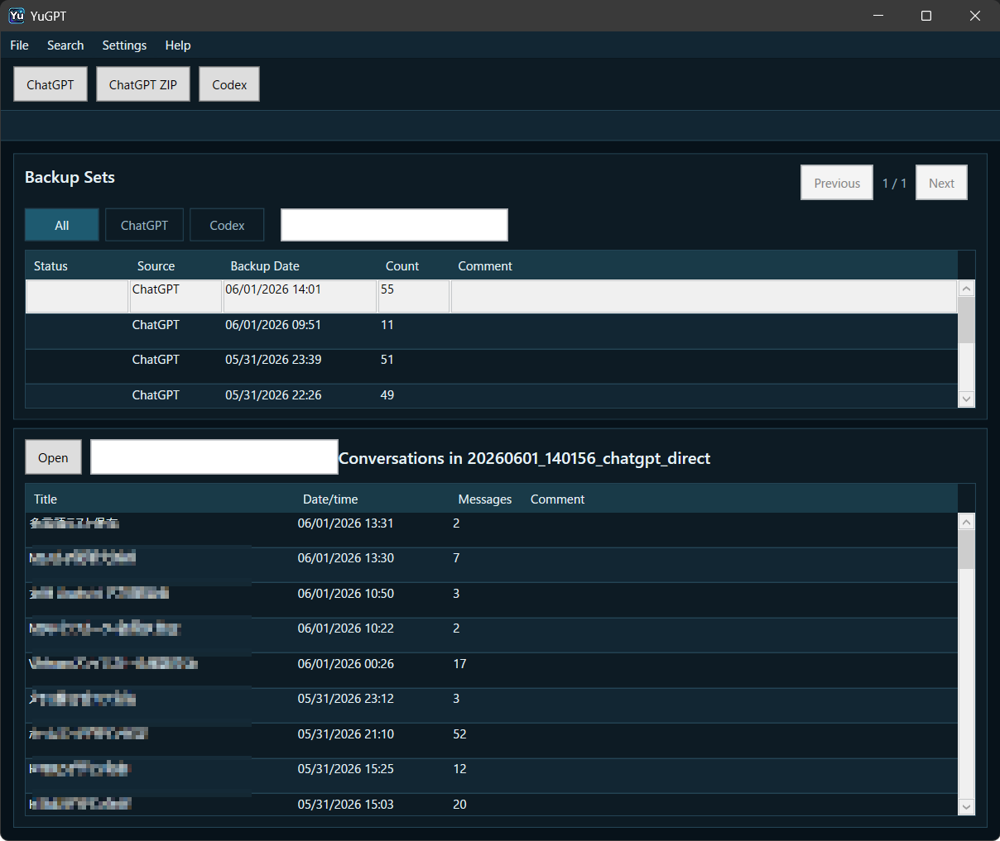
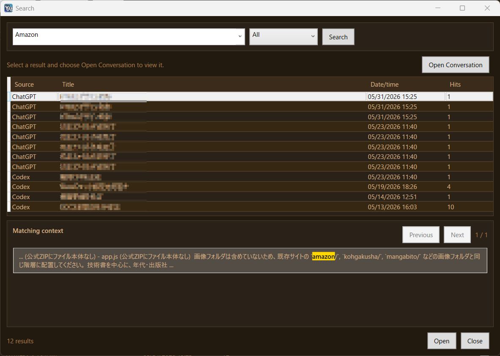
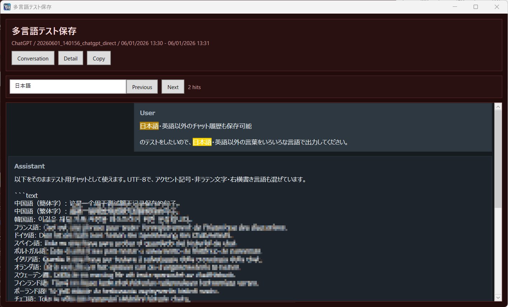

# YuGPT Free Edition

**Keep your AI conversations close. Back up and search ChatGPT and Codex history on your Windows PC.**

Turn your AI conversations into a local archive you can read again. Save readable UTF-8 Markdown files, browse backup sets, and find the conversation you need without searching through separate histories.

**[Download YuGPT Free Edition](https://github.com/yutakahirata50/YuGPT-releases/releases/latest)**

For **Windows 11 on Intel/AMD 64-bit PCs**. Free for personal and commercial use.

## Import. Keep. Find.

- **Import ChatGPT exports.** Import an official ChatGPT export ZIP containing `conversations.json` and keep a readable local copy of your conversations.
- **Bring Codex history together.** Import local Codex session history and browse it alongside your ChatGPT backups.
- **Keep readable files.** Store conversations as UTF-8 Markdown on your PC. Save attachments when they are available in the source history.
- **Find past answers.** Search saved conversations, inspect matching context, and open the result to read the conversation.
- **Browse your archive.** Filter backup sets by source and review conversation titles, dates, and message counts.
- **Make it comfortable.** Choose an English or Japanese interface and adjust the app's theme.

## Read the conversation behind the result

Open a saved conversation, search within it, and move between matching passages. UTF-8 storage preserves multilingual text so your archive can include conversations in different languages.

*Screenshots illustrate the interface and shared features. Edition-specific limits are listed below; appearance may vary with the selected theme.*

## Download and get started

1. Open the **[latest release](https://github.com/yutakahirata50/YuGPT-releases/releases/latest)** and expand **Assets** if necessary.
2. Download `YuGPT-…-free_edition-win-x64.zip`. The automatically generated **Source code** archives are not the application.
3. Extract the entire ZIP to a folder on your PC.
4. Run `YuGPT.App.exe` inside the extracted `YuGPT` folder.
5. Choose **ChatGPT ZIP** or **Codex** to import your history.

The Free Edition requires the **.NET 10 Desktop Runtime (Windows x64)**. Install it if it is missing on your PC.

This repository distributes official YuGPT Free Edition releases; it does not contain the application source code. See the freeware license included in the downloaded ZIP. The original, unmodified archive may be redistributed with its license included.

## Free Edition and Microsoft Store Edition

Try the local archive workflow for free, then choose the Store Edition for direct ChatGPT backup, more backup sets, or the ability to choose where your backup library is stored.

| Feature | Free Edition | Microsoft Store Edition |
| --- | --- | --- |
| Official ChatGPT ZIP import | Included | Included |
| Direct ChatGPT backup | Not included | Included |
| Local Codex history import | Included | Included |
| Markdown archive and conversation search | Included | Included |
| Backup sets | Up to 5 | No Free Edition limit |
| Choose the backup library folder | Fixed default folder | Choose a folder |

The Store Edition can back up ChatGPT directly after you sign in, without first downloading an official export ZIP. It also lets you change the folder where your backup library is stored.

**[Get YuGPT on Microsoft Store](https://apps.microsoft.com/detail/9NF57TLBGFTV)**

## Your conversations stay on your PC

YuGPT stores your archive locally. The developer does not receive your conversation history through the app. In the Store Edition, direct ChatGPT backup connects to ChatGPT when you request it; imported ZIP files and local Codex history are processed on your device.

Please verify that important backups open correctly before relying on them.

[Official website](https://yutakasan.11ya.net/winapps/YuGPT/) · [Privacy policy](https://yutakasan.11ya.net/winapps/YuGPT/privacy.html)
